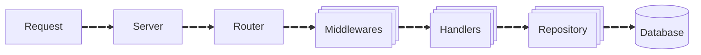

# Blog Post

This project is a backend service for managing blog posts using Go.

<p align="center">
  
  
  
  
</p>


## 🎯 Features
- Create, read, update, delete blog posts, add comments
- JWT authentication
- Built using Fiber framework
- For Database used PostgreSQL and GORM for ORM Tool

## 🚀 Installation
1. Clone the repo: `git clone https://github.com/NishanthSaravanan/Senthil-Nov2025-RTE.git`
2. Install dependencies: `go mod tidy`
3. Run the app: `go run main.go`

## Usage
- Register a user via `/api/v1/auth/register`
- Log in via `/api/v1/auth/login` to get a JWT token
- Use the token to access protected routes like `/api/v1/public/posts`
## 📁 Project Structure

```
RTE_blog/
├── main.go
├── config/        # Configuration management
├── db/            # Database repositories and data access
├── routes/        # Router definitions
├── handlers/      # HTTP request handlers
├── models/        # Application models
├── middleware/    # HTTP middleware components
└── go.mod
```

### ➡️ Control Flow



1. **Request**: Server receives the incoming request.
2. **Server**: Server processes the request and forwards it to the router.
3. **Router**: Router directs the request to the appropriate middleware(s).
4. **Middlewares**: The middlewares handle various tasks such as logging, authentication, security headers, tracing etc.,
5. **Handlers**: The request is passed to the appropriate handler, which validates the request and forwards it to the repository layer.
6. **Repository**: The repository layer communicates with the database to perform CRUD operations.


## 🛠 Tools & Stack

| Category | Technology |
|----------|-----------|
| **Web Framework** | [Fiber](https://github.com/gofiber/fiber) |
| **Logging** | [Logrus](https://pkg.go.dev/github.com/sirupsen/logrus@v1.9.3) |
| **Database** | [PostgreSQL](https://pkg.go.dev/gorm.io/driver/postgres@v1.6.0) |
| **ORM Tool** | [GORM](https://pkg.go.dev/gorm.io/gorm@v1.31.1) |


## Contributing
Feel free to fork the repo and submit pull requests.

## Author
Senthilkanagaraj

GitHub: https://github.com/Senthilkanagaraj